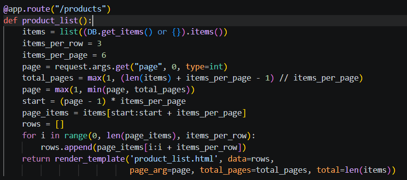
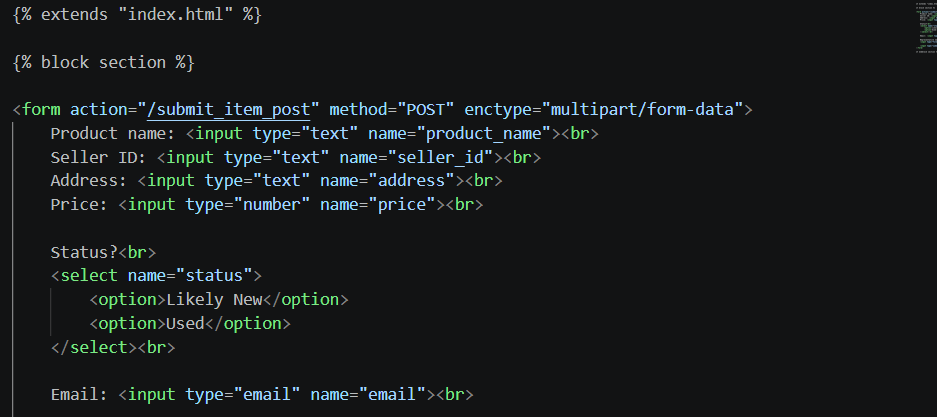
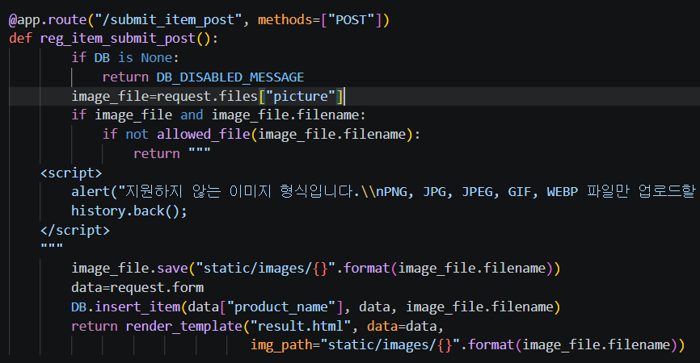

# Flask의 request.args, request.form, request.files는 어떻게 다를까?

**Category: Concept**

## HTML에서 입력한 값은 서버에 어떻게 전달될까?

영크크 팀 프로젝트에서는 Flask와 Firebase를 사용해 상품을 등록하고 조회하는 웹사이트를 개발하고 있다. 상품 등록 화면에는 상품명과 가격을 입력하는 칸이 있고, 상품 사진을 선택하는 기능도 있다. 상품 목록에서는 페이지 번호를 눌러 다른 상품들을 확인할 수 있다.

이 기능들은 모두 사용자의 선택이나 입력을 서버에 전달한다는 공통점이 있다. 그런데 Flask 코드를 살펴보면 입력값을 가져오는 방법이 하나로 통일되어 있지 않다. 페이지 번호는 `request.args`에서 읽고, 상품 정보는 `request.form`에서 읽으며, 사진은 `request.files`에서 가져온다.

이 글에서는 세 가지가 어떤 차이를 가지는지 정리한다. 프로젝트의 전체 기능을 설명하기보다는, **요청에 포함된 데이터의 위치와 종류에 따라 접근 방법이 달라진다는 개념**을 이해하는 것이 목표다.

## 1. request는 현재 요청에 담긴 정보를 제공한다

브라우저에서 링크를 누르거나 입력 양식을 제출하면 서버에 HTTP 요청이 전달된다. Flask에서는 `request`를 통해 현재 요청의 정보를 확인할 수 있다.

```python
from flask import request
```

여기서 `request`는 데이터베이스에 저장된 정보를 가져오는 객체가 아니다. 지금 서버에 도착한 요청의 URL 매개변수, 폼 데이터, 업로드 파일 등을 확인할 때 사용하는 객체다. Flask가 요청을 처리하는 동안 해당 요청의 정보에 접근할 수 있도록 제공한다.

이번 프로젝트에서 살펴볼 세 가지 속성은 다음과 같다.

| 속성 | 읽는 데이터 | 프로젝트 예시 |
|---|---|---|
| `request.args` | URL의 쿼리 문자열 | 목록의 페이지 번호 |
| `request.form` | 요청 본문에 담긴 일반 폼 필드 | 상품명, 가격, 주소 |
| `request.files` | 업로드된 파일 | 상품 사진 |

이 구분에서 중요한 기준은 **데이터가 어디에 어떤 형태로 전달되었는가**이다.

## 2. request.args: URL에 담긴 값을 읽기

상품 목록의 두 번째 페이지를 요청하는 주소를 예로 들어 보자.

```text
/products?page=2
```

`/products`는 요청할 경로이고, `?` 뒤의 `page=2`는 쿼리 문자열이다. 서버는 이 값을 읽어 사용자가 어떤 페이지를 보고 싶은지 판단할 수 있다.

프로젝트의 상품 목록 처리 코드에는 다음과 같은 부분이 있다.

```python
page = request.args.get("page", 0, type=int)
```

이 코드는 쿼리 문자열에서 `page`라는 이름의 값을 찾는다. `type=int`는 읽은 값을 정수로 변환하도록 지정한다. 값이 없거나 정수로 변환할 수 없으면 기본값인 `0`을 사용한다.

프로젝트에서는 이후 다음 코드로 페이지 번호를 보정한다.

```python
page = max(1, min(page, total_pages))
```

따라서 기본값이 `0`이라고 해서 실제로 0페이지를 보여주는 것은 아니다. 전체 페이지 수를 계산한 뒤, 페이지 번호가 1 이상이고 마지막 페이지 이하가 되도록 조정한다.

이처럼 쿼리 문자열은 목록 조회 조건을 주소로 표현할 때 사용할 수 있다. 11주차 강의에서 다룬 정렬 기준, 카테고리, 검색어도 같은 방식으로 전달할 수 있다.



*그림 1. app.py에서 request.args를 이용한 페이지 번호 처리 코드*

## 3. request.form: 일반 입력 필드의 값을 읽기

상품 등록 화면에서는 사용자가 여러 정보를 입력한 뒤 등록 버튼을 누른다. 프로젝트의 폼은 다음 설정을 사용한다.

```html
<form action="/submit_item_post"
      method="POST"
      enctype="multipart/form-data">
```

위 코드는 폼의 시작 부분을 발췌한 것이다. 입력한 데이터를 `/submit_item_post` 경로에 POST 방식으로 전송하며, 파일도 함께 전달할 수 있도록 인코딩 형식을 지정한다.

상품명을 입력하는 필드는 다음과 같다.

```html
<input type="text" name="product_name">
```

서버에서는 해당 필드의 값을 다음과 같이 읽는다.

```python
data = request.form
product_name = data["product_name"]
```

여기서 HTML과 Python을 연결하는 것은 `name="product_name"`이다. 입력창 옆에 표시한 문구나 CSS에서 사용하는 `id`가 아니라, **폼 필드의 `name`이 서버에서 값을 찾는 이름**이 된다.

또한 숫자 입력창을 사용하더라도 일반 폼 값은 문자열로 전달된다. 프로젝트의 `database.py`에서는 가격을 저장하기 전에 다음과 같이 정수로 변환한다.

```python
"price": int(data["price"])
```

이는 화면의 입력 형식과 서버에서 사용하는 자료형을 구분해야 한다는 의미다. 실제 서비스에서는 빈 값이나 잘못된 숫자가 들어오는 경우도 함께 처리해야 한다.



*그림 2. 상품 등록 폼의 POST 방식 및 multipart/form-data 설정*

## 4. request.files: 업로드된 파일을 읽기

상품 사진은 상품명과 달리 파일 데이터다. 프로젝트의 사진 입력 필드는 다음과 같다.

```html
<input type="file" name="picture">
```

서버에서는 `request.form` 대신 `request.files`를 사용한다.

```python
image_file = request.files["picture"]
```

`picture`는 파일 입력 필드의 `name`과 일치한다. 가져온 객체에서는 파일 이름을 확인하거나 파일을 저장할 수 있다.

파일 업로드에는 앞서 확인한 `enctype="multipart/form-data"` 설정이 필요하다. 이 형식의 요청에서는 일반 입력 필드는 `request.form`으로, 파일 부분은 `request.files`로 접근한다.

**같은 폼에서 전송한 데이터라도 일반 값과 파일은 구분해서 읽는 것이다.**

프로젝트에서는 업로드된 사진을 `static/images`에 저장하고, 상품 정보와 함께 파일 이름을 데이터베이스에 전달한다. 따라서 파일을 받는 일과 상품 정보를 저장하는 일도 서로 다른 처리 단계다.



*그림 3. request.form과 request.files를 이용한 상품 등록 데이터 처리 코드*

## 5. GET과 POST만으로 구분하면 안 되는 이유

처음에는 `request.args`를 GET 전용, `request.form`을 POST 전용이라고 외우기 쉽다. 하지만 더 정확한 기준은 요청 데이터의 위치다.

예를 들어 POST 요청을 보내는 주소에도 `?page=2` 같은 쿼리 문자열을 붙일 수 있다. 이 경우 URL에 있는 값은 여전히 `request.args`에서 읽는다. 반대로 POST 요청이라고 해서 모든 본문 데이터가 `request.form`에 들어가는 것도 아니다. JSON으로 보낸 데이터는 별도의 방법으로 읽어야 한다.

따라서 입력값이 예상대로 읽히지 않는다면 요청 방식뿐 아니라 **URL, 폼의 `name`, 전송 형식**을 함께 확인해야 한다.

## 6. 확인할 결과

브라우저 개발자 도구의 Network 탭에서 요청을 확인하면 세 가지의 차이를 직접 살펴볼 수 있다.

상품 목록을 이동할 때는 URL의 쿼리 문자열을 확인하고, 상품을 등록할 때는 요청 본문에 상품 정보와 파일 항목이 포함되는지 확인하면 된다.

각 상황에서 예상되는 데이터의 형태는 다음과 같다.

| 사용자 동작 | 전달되는 데이터 예시 | Flask에서 접근하는 방법 |
|---|---|---|
| 상품 목록 2페이지 선택 | `page=2` | `request.args` |
| 상품명 입력 | `product_name=가방` | `request.form` |
| 상품 가격 입력 | `price=10000` | `request.form` |
| 상품 사진 선택 | `bag.jpg` | `request.files` |

이를 통해 하나의 웹사이트에서도 사용자 입력의 전달 방식에 따라 서로 다른 속성이 사용된다는 것을 확인할 수 있다.


## 7. 배운 점

이번 내용을 정리하면서 서버에서 입력값을 받는 방법은 HTML의 작성 방식과 연결되어 있다는 점을 이해했다.

상품명, 페이지 번호, 사진을 모두 사용자 입력이라고 묶어 생각하기보다, 각각 어디에 담겨 전달되는지 먼저 확인하면 코드를 읽기가 쉬워진다. 특히 HTML에서 지정한 `name` 속성이 Flask에서 데이터를 가져올 때 사용하는 이름과 일치해야 한다는 점이 중요했다.

앞으로 새로운 입력 기능을 구현할 때도 화면의 입력 요소부터 요청 데이터, 서버의 처리 코드까지 연결해서 확인하려고 한다.

## 참고자료

- 수업 자료: OpenSWPlatform-11.Web application (3)
- [Flask 공식 문서 - Quickstart](https://flask.palletsprojects.com/en/stable/quickstart/)
- [Flask 공식 문서 - Request Context](https://flask.palletsprojects.com/en/stable/reqcontext/)
- [Flask 공식 문서 - Uploading Files](https://flask.palletsprojects.com/en/stable/patterns/fileuploads/)
- [Werkzeug 공식 문서 - Request / Response Objects](https://werkzeug.palletsprojects.com/en/stable/wrappers/)
- 영크크 프로젝트의 `app.py`, `database.py`, `templates/reg_items.html`

---

[← 메인 페이지로 돌아가기](./)
