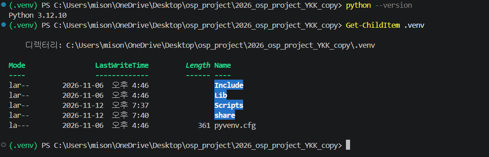
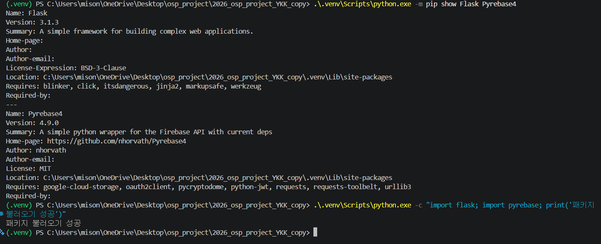
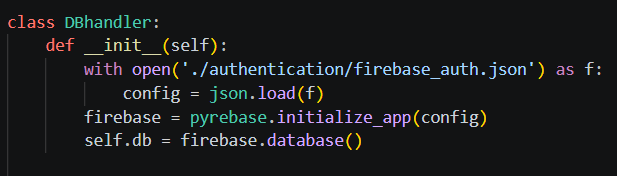
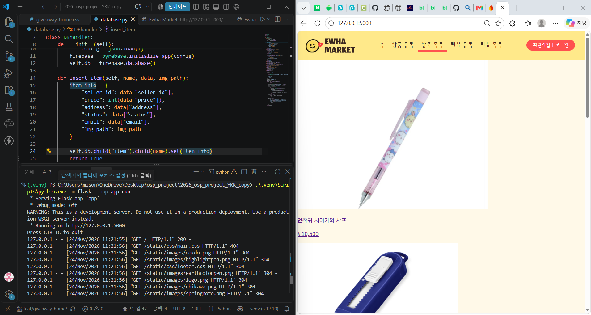

# Windows에서 영크크 프로젝트의 Flask·Firebase 실행 환경 설정하기

**Category: Guide**

## 프로젝트 코드를 실행하려면 무엇이 필요할까?

영크크 팀 프로젝트는 Flask로 웹 요청을 처리하고, Firebase Realtime Database에 상품과 사용자 정보를 저장한다. 따라서 다른 팀원의 코드를 내려받았더라도 필요한 Python 패키지와 Firebase 연결 설정이 준비되어 있어야 관련 기능을 실행할 수 있다.

이 글에서는 **Windows에서 기존 영크크 프로젝트를 실행할 수 있도록 개발 환경을 설정하는 과정**을 정리한다. 프로젝트 코드를 준비한 뒤 가상환경을 만들고, 패키지를 설치하고, 팀의 Firebase 설정을 연결해 실행을 확인하는 순서다.

새로운 Firebase 프로젝트를 만드는 과정은 다루지 않는다. Python과 Git이 설치되어 있고, 팀 저장소의 코드 및 팀에서 사용하는 Firebase 설정 파일을 준비할 수 있다는 것을 전제로 한다. 아래 명령어는 PowerShell 기준이다.

## 1. 프로젝트 루트 폴더에서 시작하기

먼저 프로젝트 폴더를 열고 `app.py`, `database.py`, `requirements.txt`가 있는지 확인한다. VS Code를 사용한다면 해당 폴더를 연 다음 터미널을 실행하면 된다.

```powershell
Get-Location
Get-ChildItem
```

첫 번째 명령어는 현재 터미널의 위치를 보여주고, 두 번째 명령어는 그 위치의 파일과 폴더를 보여준다.

프로젝트 루트에서 작업하는 이유는 코드가 상대 경로를 사용하기 때문이다. 예를 들어 `database.py`는 `./authentication/firebase_auth.json`을 읽는다. 따라서 터미널을 다른 폴더에서 실행하면 파일이 존재하더라도 예상한 위치에서 찾지 못할 수 있다.

프로젝트 파일 목록이 확인되면 Python이 실행되는지도 확인한다.

```powershell
python --version
```

버전이 출력되면 다음 단계로 진행한다. 팀에서 정한 Python 버전이 있다면 해당 버전을 사용한다.

## 2. 프로젝트 전용 가상환경 만들기

가상환경은 프로젝트에서 사용하는 Python 패키지를 별도로 관리하기 위한 환경이다. 여러 프로젝트를 진행할 때 패키지 버전이 서로 영향을 주는 상황을 줄일 수 있다. Flask 공식 문서에서도 프로젝트 의존성 관리에 가상환경 사용을 안내하고 있다.

프로젝트 루트에서 다음 명령어를 실행한다.

```powershell
python -m venv .venv
```

실행하면 `.venv` 폴더가 만들어진다.

이 글에서는 이후 명령어에서 가상환경의 Python 경로를 직접 지정한다. 이렇게 하면 가상환경 활성화 여부와 관계없이 어떤 Python에 패키지를 설치하고 어떤 Python으로 서버를 실행하는지 명확하게 알 수 있다.

가상환경은 반드시 활성화해야만 사용할 수 있는 것은 아니다.



*그림 1. Python 버전과 프로젝트 전용 가상환경의 폴더 구조 확인*

## 3. requirements.txt로 패키지 설치하기

프로젝트의 `requirements.txt`에는 실행에 필요한 패키지가 기록되어 있다. 확인한 저장소에서는 Flask와 Pyrebase4의 버전을 지정하고 있었다.

다음 명령어로 해당 파일에 기록된 패키지를 설치한다.

```powershell
.\.venv\Scripts\python.exe -m pip install -r requirements.txt
```

여기서 `-r requirements.txt`는 파일에 적힌 패키지 목록을 읽어 설치하라는 의미다. 팀에서 관리하는 목록을 사용하면 각자 임의의 버전을 설치하는 상황을 줄일 수 있다.

설치가 끝나면 두 패키지를 불러올 수 있는지 확인한다.

```powershell
.\.venv\Scripts\python.exe -c "import flask; import pyrebase; print('패키지 불러오기 성공')"
```

정상이라면 다음과 같은 문장이 출력되어야 한다.

```text
패키지 불러오기 성공
```

이때 **설치하는 패키지 이름은 `Pyrebase4`지만, Python 코드에서 불러오는 이름은 `pyrebase`**라는 점에 주의한다. 프로젝트의 `database.py`에서도 `import pyrebase`를 사용한다.



*그림 2. 가상환경에 설치된 Flask와 Pyrebase4 패키지 및 모듈 불러오기 확인*

## 4. Firebase 설정 파일 배치하기

프로젝트의 데이터베이스 연결 코드는 다음과 같다.

```python
with open('./authentication/firebase_auth.json') as f:
    config = json.load(f)

firebase = pyrebase.initialize_app(config)
self.db = firebase.database()
```

먼저 JSON 파일에서 연결 설정을 읽는다. 그 설정으로 Pyrebase를 초기화한 뒤, Realtime Database에 접근할 객체를 만든다.

따라서 팀에서 전달받은 설정 파일을 다음 위치에 배치해야 한다.

```text
authentication/firebase_auth.json
```

이 경로는 `app.py`가 있는 프로젝트 루트를 기준으로 한다. `authentication` 폴더가 없다면 해당 이름으로 폴더를 만든 후 파일을 넣는다.

설정이 완료되면 프로젝트의 주요 폴더 구조는 다음과 같은 형태가 된다.

```text
프로젝트 루트/
├── .venv/
├── authentication/
│   └── firebase_auth.json
├── static/
├── templates/
├── app.py
├── database.py
├── requirements.txt
└── test_firebase.py
```

설정 파일에는 팀 Firebase 프로젝트에 대응하는 값이 들어 있어야 한다. 특히 데이터베이스 주소는 프로젝트에서 실제로 사용하는 Realtime Database의 주소여야 하므로, 다른 예제의 주소를 그대로 복사하면 안 된다.

현재 팀 저장소의 `.gitignore`에는 다음 항목들이 제외 대상으로 등록되어 있다.

```text
authentication/
.venv/
venv/
.env
```

따라서 저장소를 내려받아도 Firebase 설정 파일이나 가상환경이 함께 생기지 않는다. 이 파일과 환경은 각자의 컴퓨터에서 별도로 준비해야 한다.

또한 설정 파일의 실제 내용을 기술블로그나 공개 저장소에 그대로 게시하지 않도록 주의한다.



*그림 3. database.py에서 Firebase 설정 파일을 읽고 데이터베이스 객체를 초기화하는 코드*

## 5. Firebase 읽기·쓰기 확인하기

패키지를 불러올 수 있다는 것과 실제 데이터베이스에 접근할 수 있다는 것은 다른 확인 단계다.

프로젝트에는 연결 상태를 확인하기 위한 `test_firebase.py`가 있으므로 다음 명령어로 실행한다.

```powershell
.\.venv\Scripts\python.exe test_firebase.py
```

현재 테스트 파일은 Firebase의 `test` 경로에 다음 데이터를 저장한 뒤 다시 읽는다.

```python
{"message": "hello firebase"}
```

읽어온 값이 저장한 값과 일치하면 아래와 같은 결과가 출력되어야 한다.

```text
{'message': 'hello firebase'}
Firebase 읽기/쓰기 테스트 성공
```

이는 정상 실행 시 예상되는 출력이다. 테스트는 기존 `test` 경로의 값을 교체하므로, 팀에서 해당 경로를 테스트 용도로 사용하는지 확인하고 실행한다.

설정 파일을 읽는 데 성공했더라도 접근 권한이 맞지 않으면 데이터베이스 요청이 실패할 수 있다. 그런 경우에는 팀에서 사용하는 Firebase 접근 설정과 인증 방식을 확인해야 한다.

## 6. Flask 서버 실행하기

데이터베이스 연결을 확인했다면 Flask 서버를 실행한다.

```powershell
.\.venv\Scripts\python.exe -m flask --app app run
```

`--app app`은 프로젝트의 `app.py`에서 Flask 애플리케이션을 찾도록 지정한다. 정상적으로 실행되면 터미널에 접속 주소가 표시된다.

기본 설정에서는 다음 주소로 접속한다.

```text
http://127.0.0.1:5000
```

브라우저에서 이 주소를 열어 홈 화면이 표시되는지 확인한다. 이 서버는 로컬 개발과 확인을 위한 서버다.

이어서 상품 목록처럼 데이터베이스를 사용하는 화면도 확인한다. 홈 화면이 열리는 것만으로 모든 연결이 정상이라고 판단하지 않고, 데이터베이스 조회가 필요한 기능까지 확인하는 것이 좋다.

확인이 끝나면 서버를 실행한 터미널에서 `Ctrl+C`를 눌러 종료한다.



*그림 4. Flask 개발 서버 실행 및 로컬 웹사이트 홈 화면 접속 결과*

## 7. 실행 결과 확인 및 오류 해결

프로젝트 실행 환경을 설정한 후에는 다음 항목을 순서대로 확인한다.

| 확인 항목 | 정상 실행 기준 |
|---|---|
| Python 설치 | Python 버전 출력 |
| 가상환경 생성 | `.venv` 폴더 생성 |
| 패키지 설치 | Flask와 Pyrebase 불러오기 성공 |
| Firebase 설정 | 설정 파일을 정상적으로 읽음 |
| 데이터베이스 연결 | 읽기·쓰기 테스트 성공 |
| Flask 서버 | 로컬 웹사이트 접속 가능 |

실행 중 오류가 발생한다면 모든 설정을 처음부터 다시 진행하기보다 어느 단계에서 문제가 발생했는지 확인하는 것이 효율적이다.

예를 들어 패키지를 찾을 수 없다는 오류가 발생하면 가상환경의 Python을 사용하고 있는지 확인한다. 설정 파일을 찾을 수 없다는 오류가 발생하면 현재 터미널의 위치와 `authentication` 폴더의 경로를 확인한다.

Firebase 접근 오류가 발생한다면 데이터베이스 주소와 팀에서 사용하는 접근 권한 및 인증 설정을 확인한다.

이처럼 실행 환경을 단계별로 점검하면 문제의 원인을 좁힐 수 있다.

## 8. 배운 점

프로젝트 실행 환경을 준비할 때는 소스 코드, 설치된 패키지, 외부 서비스 연결 설정을 각각 확인해야 한다. 코드가 같더라도 다른 Python 환경으로 실행하거나 Firebase 설정 파일이 빠져 있으면 실행 결과가 달라질 수 있다.

이번 내용을 정리하면서 실행 오류를 확인하는 순서도 이해할 수 있었다. 먼저 현재 폴더와 Python 경로를 확인하고, 다음으로 패키지를 불러올 수 있는지 확인한다. 그다음 설정 파일과 데이터베이스 연결을 확인하면 문제가 발생한 단계를 좁힐 수 있다.

팀 프로젝트에서는 기능을 구현하는 것뿐 아니라, 다른 팀원이 같은 코드를 실행할 수 있도록 준비 과정을 설명하는 것도 필요하다. 특히 가상환경과 `requirements.txt`를 활용하면 팀원 간의 개발 환경 차이를 줄일 수 있다는 점을 알게 되었다.

이 안내는 팀원들이 프로젝트의 실행 과정을 공유하고, 새로운 개발 환경에서도 동일한 코드를 실행할 수 있도록 하기 위한 기록이다.

## 참고자료

- [Python 공식 문서 - venv](https://docs.python.org/3/library/venv.html)
- [Flask 공식 문서 - Installation](https://flask.palletsprojects.com/en/stable/installation/)
- [Flask 공식 문서 - Quickstart](https://flask.palletsprojects.com/en/stable/quickstart/)
- [Pyrebase4 공식 저장소](https://github.com/nhorvath/Pyrebase4)
- 영크크 프로젝트의 `requirements.txt`, `database.py`, `test_firebase.py`, `.gitignore`

---

[← 메인 페이지로 돌아가기](./)
