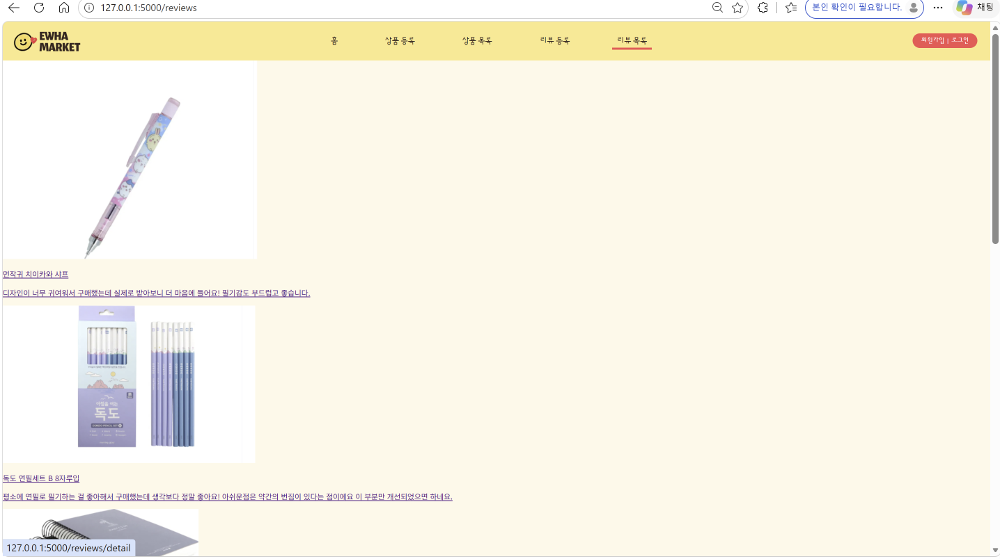
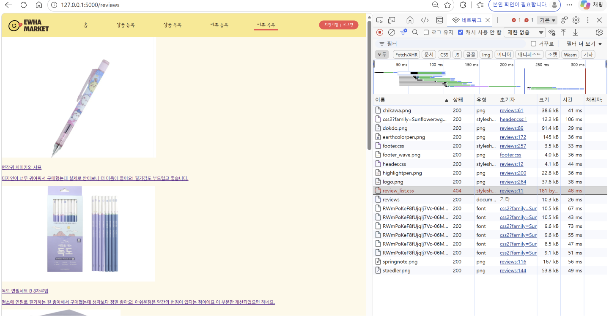
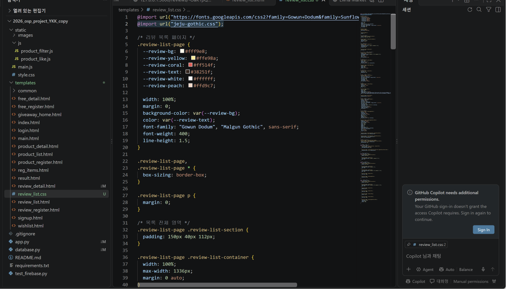
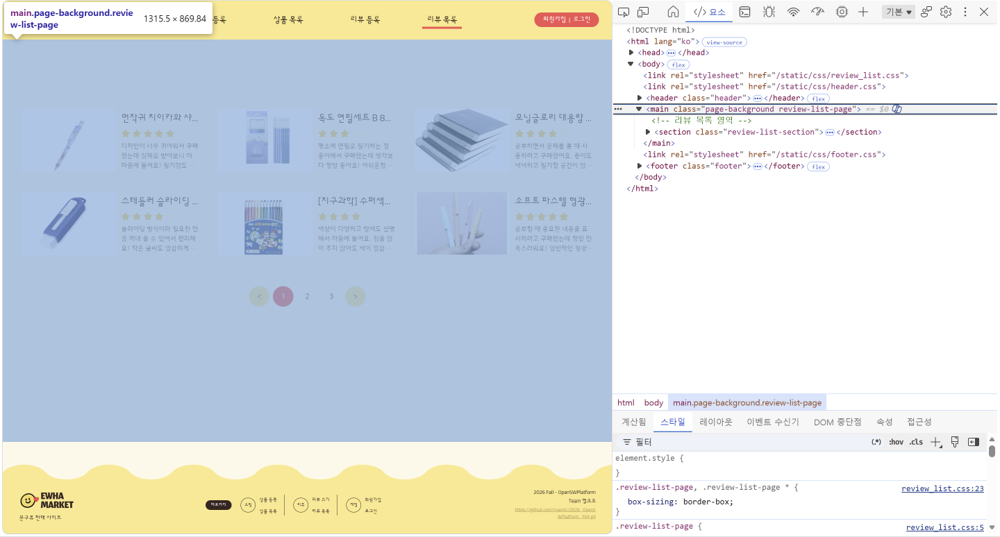
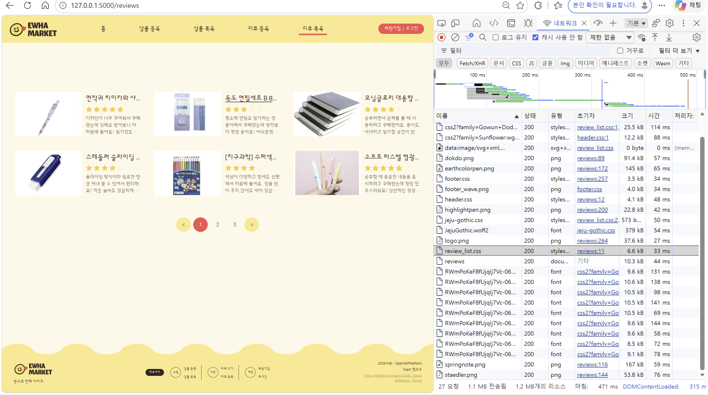
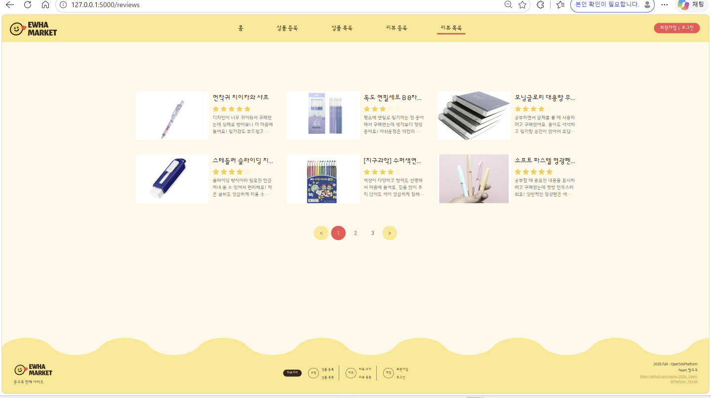

 
# Flask에서 CSS가 적용되지 않을 때 url_for('static') 경로 확인하기
 
**Category: Debugging**
 
## 분명히 CSS를 작성했는데 화면에 적용되지 않는다면?
 
영크크 팀 프로젝트에서는 Flask와 Firebase를 사용한 문구점 마켓 웹사이트를 개발하고 있다. 그중 리뷰 목록 페이지인 HTML 템플릿(`review_list.html`)과 스타일 파일(`review_list.css`)을 작성했다. 이 화면은 리뷰 카드를 3열로 배치하고, 카드마다 본문을 미리 보여 주며, 아래쪽에 페이지네이션 버튼이 있다.
 
HTML과 CSS를 모두 작성한 뒤 서버를 실행했는데, 기대한 화면 대신 디자인이 적용되지 않은 화면이 나타났다. 헤더와 푸터는 정상적으로 보였지만, 리뷰 목록의 페이지네이션 버튼 디자인도, 카드 배치도 보이지 않고 글자와 이미지만 위에서 아래로 나열되어 있었다. 코드를 다시 읽어 봐도 CSS 문법에는 문제가 없어 보였다.
 
이 글에서는 **CSS가 적용되지 않을 때 코드를 고치기 전에 무엇부터 확인해야 하는지**를 정리한다. 특히 Flask에서 정적 파일을 불러오는 `url_for('static', ...)`가 어떤 주소를 만드는지 이해하고, 브라우저 개발자 도구로 원인을 좁히는 과정을 다룰 것이다.
 
## 1. 증상: 디자인이 없는 화면
 
먼저 증상을 정확히 정리했다. 문제를 막연하게 "CSS가 안 된다"고 생각하면 원인을 찾기 어렵기 때문이다.
 
기대한 화면은 연한 노란 배경 위에 3열 카드, 둥근 페이지네이션 버튼이 있는 모습이었다. 실제로는 배경에 리뷰가 세로로 나열되고 페이지네이션에 보이는 버튼 디자인도 적용되지 않았다.
 
HTML 내용은 모두 표시되는데 스타일만 빠져 있었다. 이는 템플릿 자체는 정상적으로 렌더링되었고, **CSS 파일을 불러오는 단계에서 문제가 생겼을 가능성**이 높다는 뜻이다.
 

 
*그림 1. CSS가 적용되지 않은 리뷰 목록 화면*
 
## 2. url_for('static')이 만드는 주소 이해하기
 
템플릿에서 CSS를 불러오는 부분은 다음과 같다.
 
```html
<link rel="stylesheet" href="{{ url_for('static', filename='css/review_list.css') }}">
```
 
`{{ ... }}` 안의 코드는 서버가 HTML을 만들 때 실행되고, 결과 문자열로 바뀐다. 이 코드는 브라우저에는 다음과 같은 주소로 전달된다.
 
```html
<link rel="stylesheet" href="/static/css/review_list.css">
```
 
`url_for('static', filename='...')`는 Flask가 기본으로 제공하는 `static` 경로를 이용해 **프로젝트의 `static` 폴더 안에 있는 파일 주소**를 만들어 준다. 따라서 브라우저가 `/static/css/review_list.css`를 요청하면, 서버는 프로젝트의 `static/css/review_list.css` 파일을 찾아 응답한다.
 
여기서 중요한 점이 두 가지 있다.
 
- `filename`은 **`static` 폴더를 기준으로 한 상대 경로**다. 그래서 `static/`은 적지 않고 `css/review_list.css`만 적는다.
- 파일이 그 위치에 없으면 서버가 응답할 파일을 찾지 못하고, 브라우저는 스타일 없이 HTML만 표시한다. 이때 화면에 오류 메시지가 나타나지 않기 때문에 원인을 알아차리기 어렵다.

## 3. Network 탭으로 요청 상태 확인하기
 
브라우저는 CSS 파일을 요청한 결과를 개발자 도구에 기록한다. `F12`를 눌러 개발자 도구를 열고 **Network** 탭을 선택한 뒤, 페이지를 새로고침(`Ctrl+R`)하면 요청 목록이 나타난다. 목록에서 `review_list.css`를 찾아 **Status** 열을 확인한다.
 

 
*그림 2. Network 탭에서 review_list.css의 Status가 404로 표시된 화면*
 
`review_list.css`의 Status가 **404 (Not Found)** 였다. 서버가 요청한 주소에서 파일을 찾지 못했다는 뜻이다. Flask를 실행한 터미널에도 같은 내용이 기록된다.
 
```text
"GET /static/css/review_list.css HTTP/1.1" 404 -
```
 
이렇게 브라우저와 터미널 두 곳에서 같은 결과를 확인하면, CSS 문법이나 브라우저 문제가 아니라 **서버가 파일을 찾지 못하는 문제**라는 것이 분명해진다. 상태 코드별로 의심할 곳은 다음과 같이 나뉜다.
 
| Status | 의미 | 의심할 곳 |
|---|---|---|
| 200 | 파일을 정상적으로 받음 | CSS 내용, 선택자, 캐시 |
| 304 | 저장된 파일을 그대로 사용함 | 브라우저 캐시 |
| 404 | 서버에서 파일을 찾지 못함 | 파일 위치, 폴더와 파일 이름 |
 
## 4. 원인 찾기: 파일 위치와 이름 확인
 
404라는 사실을 확인했으니, 이제 프로젝트 폴더에서 `review_list.css`가 실제로 어디에 있는지 확인한다. 이 문제는 다음과 같은 이유로 자주 발생한다.
 
| 원인 | 잘못된 예 | 올바른 예 |
|---|---|---|
| `css` 폴더 없이 `static`에 바로 저장 | `static/review_list.css` | `static/css/review_list.css` |
| 폴더 이름 오타 | `statics/css/...` | `static/css/...` |
| 파일 이름 오타 | `review-list.css` | `review_list.css` |
| 대소문자 불일치 | `Review_list.css` | `review_list.css` |
| `templates` 폴더에 저장 | `templates/review_list.css` | `static/css/review_list.css` |
 
특히 대소문자는 주의해야 한다. Windows에서는 대소문자를 구분하지 않아 문제없이 동작하더라도, 나중에 Linux 서버에 배포하면 파일을 찾지 못할 수 있다. 처음부터 파일 이름을 소문자와 밑줄로 통일하는 것이 안전하다.
 
이번 문제는 CSS 파일이 템플릿이 가리키는 `static/css/` 폴더가 아닌 곳에 있었던 것이 원인이었다. 코드와 실제 파일 위치가 서로 달랐던 것이다.
 

 
*그림 3. 프로젝트 폴더 구조에서 review_list.css의 위치 확인*
 
## 5. 해결하기: 폴더 구조 맞추기
 
CSS 파일을 템플릿이 가리키는 위치로 옮겼다. 프로젝트는 다음과 같은 구조가 되어야 한다.
 
```text
project/
├── app.py
├── templates/
│   └── review_list.html
└── static/
    ├── css/
    │   └── review_list.css
    └── images/
        └── chikawa.png
```
 
이 구조에서는 `url_for('static', filename='css/review_list.css')`가 가리키는 `/static/css/review_list.css`와 실제 파일 위치가 일치한다. 템플릿 코드를 고치는 방법도 있지만, 팀 프로젝트에서는 다른 팀원의 화면도 같은 규칙을 사용하므로 **파일을 규칙에 맞는 위치로 옮기는 편이 안전하다**고 판단하였다.
 
파일을 옮긴 뒤에는 Flask 서버를 다시 실행하고 `Ctrl+F5`로 새로고침을 한다. 
 
## 6. 404가 아닌데도 적용되지 않는다면
 
경로를 맞췄는데도 화면이 그대로인 경우도 있다. 이때 Network 탭에서 `review_list.css`의 Status가 **200**이라면, 파일은 정상적으로 불러왔지만 내용이 적용되지 않는 것이다. 이 경우에는 다음 세 가지를 차례로 확인한다.
 
**첫째, 선택자의 범위를 확인한다.** 리뷰 목록 CSS는 대부분의 규칙이 `.review-list-page` 아래에 작성되어 있다.
 
```css
.review-list-page .review-list {
  display: grid;
  grid-template-columns: repeat(3, minmax(0, 1fr));
}
```
 
이 규칙은 `review-list-page` 클래스를 가진 요소 **안쪽**의 `.review-list`에만 적용된다. 그래서 HTML에서 바깥 요소에 이 클래스가 없으면 CSS 파일은 불러왔어도 스타일이 적용되지 않는다. 템플릿에서는 다음처럼 `main`에 클래스를 지정해야 한다.
 
```html
<main class="page-background review-list-page">
```
 
**둘째, CSS 안의 `@import` 경로를 확인한다.** CSS 파일 첫 부분에는 폰트 파일을 불러오는 코드가 있다.
 
```css
@import url("jeju-gothic.css");
```
 
이 주소는 HTML이 아니라 **CSS 파일이 있는 위치를 기준**으로 해석된다. 따라서 `jeju-gothic.css`가 `static/css/` 폴더에 없으면 이 폰트만 적용되지 않고, 다음 순서의 대체 폰트(`Malgun Gothic`)가 사용된다. 이 경우에도 Network 탭에서 `jeju-gothic.css`의 404를 확인할 수 있다.
 
**셋째, 브라우저 캐시를 확인한다.** Status가 304이거나 수정한 내용이 반영되지 않는다면 `Ctrl+F5`로 다시 불러온다. 개발자 도구의 Network 탭에서 **Disable cache**를 체크해 두면 개발 중에 이전 파일이 사용되는 문제를 줄일 수 있다.
 

 
*그림 4. Elements 탭에서 요소의 클래스와 적용된 CSS 규칙 확인*
 
## 7. 확인할 결과
 
경로를 수정하고 강력 새로고침을 하자 Network 탭에서 `review_list.css`의 Status가 **200 (OK)** 으로 바뀌었다.
 

 
*그림 5. 수정 후 Network 탭에서 review_list.css의 Status가 200으로 표시된 화면*
 
화면에서도 의도한 디자인이 정상적으로 나타났다. 노란 배경 위에 리뷰 카드가 3열로 배치되었고, 별점과 페이지네이션 버튼도 설계한 모양으로 표시되었다.
 

 
*그림 6. CSS가 정상적으로 적용된 리뷰 목록 화면*
 
## 8. 배운 점
 
이번 문제를 해결하면서 CSS가 적용되지 않을 때 가장 먼저 해야 할 일은 **CSS 코드를 다시 읽는 것이 아니라, 브라우저가 CSS 파일을 제대로 받았는지 확인하는 것**임을 알게 되었다. Network 탭에서 Status 하나만 확인해도 문제의 범위가 경로 문제와 스타일 문제로 크게 나뉘기 때문이다.
 
또한 `url_for('static', filename=...)`의 `filename`이 `static` 폴더를 기준으로 한 경로라는 점을 이해하게 되었다. 이 규칙을 알고 있으면 CSS와 이미지, 폰트처럼 정적 파일과 관련된 문제를 같은 방식으로 확인할 수 있다.
 
앞으로 같은 문제가 생기면 다음 순서로 확인하려고 한다.
 
1. `F12`를 눌러 Network 탭을 열고 새로고침한다.
2. CSS 파일의 Status를 확인한다. (404이면 경로 문제)
3. 프로젝트 폴더에서 폴더와 파일 이름, 대소문자를 확인한다.
4. 200이면 HTML의 클래스와 CSS 선택자가 일치하는지 확인한다.
5. 수정 후에는 `Ctrl+F5`로 강력 새로고침을 한다.

## 참고자료
 
- 수업 자료: OpenSWPlatform-11.Web application (3)
- [Flask 공식 문서 - Static Files](https://flask.palletsprojects.com/en/stable/quickstart/#static-files)
- [Flask 공식 문서 - API (url_for)](https://flask.palletsprojects.com/en/stable/api/#flask.url_for)
- [Chrome DevTools - Network 패널](https://developer.chrome.com/docs/devtools/network)
- [MDN - HTTP 404 Not Found](https://developer.mozilla.org/ko/docs/Web/HTTP/Reference/Status/404)
---
 
[← 메인 페이지로 돌아가기](./)
 
